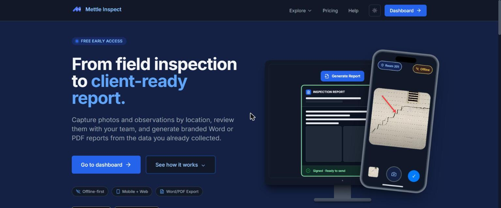
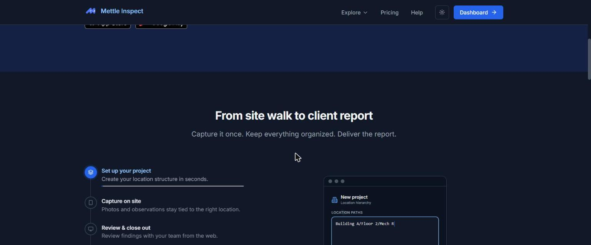
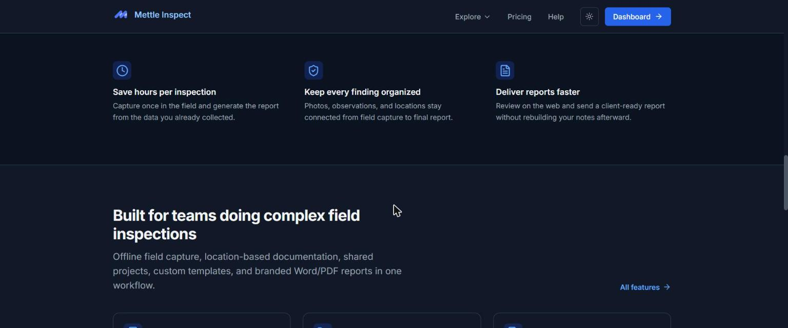

<h1 align="center">Mettle Inspect</h1>

  <b>From field inspection to client-ready report.</b> 
  Capture photos and observations by location, review them with your team, and generate branded Word or PDF reports.

  <a href="https://mettleinspect.com"><b>mettleinspect.com</b></a> · Available on the App Store and Google Play

  
  
  

> **Showcase repository.** Mettle Inspect is a commercial product I co-founded, so the source code is private. This page gives an overview of the product and my role.

  

## What it does

Inspectors walk a site, take photos, write notes, and then spend hours back at the office matching everything up and rebuilding it into a report. Mettle removes that second step: capture it once in the field, and the report comes from the data you already collected.

- **Offline-first field capture** on iOS and Android: photos and observations stay tied to the right location, even without signal.
- **Location-based documentation:** set up the project's location structure (building, floor, room) in seconds.
- **Team workspace:** shared projects, roles and invites, with review on the web.
- **Branded reports:** custom templates and Word/PDF export, ready to send to the client.

  

  

## My role

Co-founder and engineer. We co-own the product. I worked mostly on the frontend and the secure connection between the app and the backend.

## Tech

- React Native mobile app, published on the App Store and Google Play
- Web dashboard for review and report export

---

  Co-founded by <a href="https://www.linkedin.com/in/ulises-a-cheong-borges-1b06a540a/">Ulises A. Cheong Borges</a> · Miami, FL

